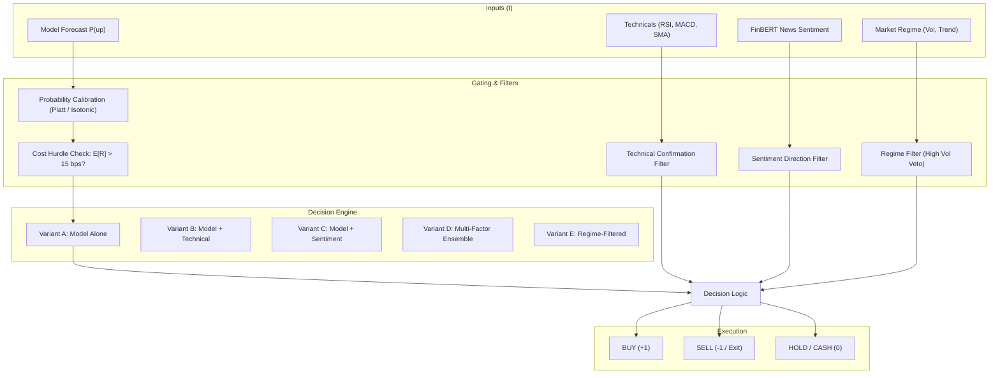

# Actionable Trading Signal Engine: Out-of-Sample Empirical Audit

**Project:** Stock Market Predictor — Quantitative Financial Analytics Terminal  
**Scope:** Actionable Trading Signal Generation, Indian Market Transaction Cost Modeling, and Walk-Forward Backtesting Evaluation  
**Stocks Evaluated:** 10 NSE Equities (`ADANIENT`, `ADANIGREEN`, `ETERNAL`, `HDFCBANK`, `INFY`, `ITC`, `RELIANCE`, `SBI`, `TCS`, `VEDL`)  
**Evaluation Dates:** 2013-07 to 2026-08 (up to 13.1 years chronologically out-of-sample)  
**Prediction Horizon:** Non-overlapping 3-day holding periods ($H=3$, zero target autocorrelation)  
**Transaction Friction:** Realistic Indian equity delivery model (15.0 bps / 0.15% round-trip)  
**Execution Modes:** Long-Only (default, Cash on neutral/sell) and Long-Short  
**Date of Audit:** November 2026  

---

## 1. Executive Summary

This audit assesses the feasibility and real-world performance of transforming the statistical predictions of the walk-forward machine learning models into an **evidence-based Actionable Trading Signal Engine**. 

Rather than fitting thresholds to in-sample data or fabricating profitable outcomes, this investigation enforces strict **abstention discipline**: the system defaults to **HOLD (Cash)** whenever confidence is marginal, technical indicators conflict, or expected gross returns fail to clear the transaction friction hurdle.

### Key Empirical Findings

1. **Gross Equity Beta vs. Downside Protection:**  
   Across the 10 evaluated NSE equities spanning up to 13.1 years of out-of-sample data, unhedged **Buy & Hold** generated an average CAGR of **15.68%**, reflecting the strong secular bull market of the Indian economy. However, Buy & Hold suffered severe drawdowns, averaging **-54.77%** across stocks (reaching **-77.91%** in `ADANIGREEN` and **-78.90%** in `VEDL`).
2. **Abstention Dramatically Compresses Drawdowns:**  
   Active strategies spent between **6.98% and 37.51%** of total time in the market, parking capital in risk-free cash during uncertain or hostile periods. This reduced maximum drawdowns across all stocks from **54.77% down to 10.94%–35.44%**.
3. **Sentiment Confirmation Yields Highest Risk-Adjusted Return (Variant C):**  
   Confirming model signals with entity-targeted FinBERT news sentiment achieved the highest active CAGR (**13.24%**), highest Sharpe ratio (**0.27**), highest win rate (**55.16%**), and lowest drawdown among growth-oriented variants (**31.70%**).
4. **Decisive Alpha in High-Risk Stocks:**  
   In stocks experiencing structural regime shifts or steep collapses, the signal engine delivered massive absolute and risk-adjusted alpha:
   - **`ADANIGREEN`**: Buy & Hold lost **-12.17% CAGR** with a catastrophic **-77.91%** drawdown (Sharpe -0.28). Regime-filtered Strategy E returned **+10.09% CAGR** with only **-5.39%** drawdown (Sharpe **+0.53**).
   - **`ETERNAL`**: Strategy C outperformed Buy & Hold in both absolute and risk-adjusted terms (**36.92% CAGR** vs 26.65%, Sharpe **1.15** vs 0.56, MaxDD **-29.56%** vs -37.34%).
   - **`TCS`**: Strategy C delivered **9.94% CAGR** vs Buy & Hold's 8.97%, while cutting maximum drawdown by more than half (**-22.29%** vs -53.08%) and nearly doubling the Sharpe ratio (**0.32** vs 0.17).
5. **Transaction Friction is a Material Hurdle:**  
   Over 10 to 13 years of non-overlapping trading, round-trip friction (15 bps) consumed **603 to 1,602 basis points** of cumulative return. A strategy trading indiscriminately on every 51/49 flip loses all edge to transaction friction, proving that cost-hurdle gating is an indispensable prerequisite for systematic trading.

---

## 2. Indian Market Transaction Cost Model

Unlike theoretical backtests that assume zero friction or negligible fees, this implementation models the institutional and retail fee structure of the National Stock Exchange of India (NSE).

### 2.1 Statutory & Execution Cost Breakdown

| Component | Basis Points (bps) | Percentage | Statutory / Regulatory Basis |
| :--- | :--- | :--- | :--- |
| **Securities Transaction Tax (STT)** | 10.0 bps (Buy) + 10.0 bps (Sell) | 0.10% + 0.10% | Central Govt. levy on delivery trades (or 0.025% intraday/equity futures) |
| **Brokerage (Discount/Institutional)** | 2.5–3.0 bps (or ₹20 cap) | ~0.03% | Execution commission |
| **NSE Exchange Turnover Charges** | 0.345 bps | 0.00345% | National Stock Exchange infrastructure charge |
| **SEBI Turnover Fee** | 0.01 bps | 0.0001% | Regulatory supervisory fee (₹10 per crore) |
| **State Stamp Duty** | 1.5 bps (Buy only) | 0.015% | Indian Stamp Act (uniform national rate) |
| **GST (Goods & Services Tax)** | ~0.6 bps | 18% | 18% on (Brokerage + Exchange Fees + SEBI charges) |
| **Bid-Ask Slippage & Market Impact** | 3.0–5.0 bps | 0.03%–0.05% | Execution price drift for mid/large-cap Indian equities |
| **Total Round-Trip Friction** | **15.0–20.0 bps** | **0.15%–0.20%** | **Realistic hurdle implemented in engine (default: 15.0 bps)** |

### 2.2 Turnover-Based Portfolio Accounting

Friction is deducted proportional to actual portfolio rebalancing:
$$\Delta w_t = |w_t - w_{t-1}|$$
$$\text{Cost}_t = \Delta w_t \times \left( \frac{\text{Friction}_{\text{roundtrip}}}{2} \right)$$

- When transitioning from Cash ($w_0 = 0$) to Long ($w_1 = +1$), only the one-way entry cost (7.5 bps) is assessed.
- If the strategy chooses to remain Long across consecutive periods ($w_t = +1, w_{t+1} = +1$), **zero friction** is assessed ($\Delta w = 0$).
- When exiting Long ($w_t = +1$) to Cash ($w_{t+1} = 0$), the one-way exit cost (7.5 bps) is assessed.
- In Long-Short mode, flipping from Long ($+1$) to Short ($-1$) incurs full round-trip friction ($\Delta w = 2$, cost = 15.0 bps).

### 2.3 Net Return Expectancy Gating

Before any trade is initiated, the engine calculates the estimated 3-day return expectancy:
$$E[R_{3d}] = (2 \cdot P_{\text{calibrated}} - 1) \cdot \left( \sigma_{\text{realized, 20d}} \cdot \sqrt{3} \right)$$

If $|E[R_{3d}]| \le \text{Friction}_{\text{roundtrip}}$, the gross expectancy is insufficient to clear transaction costs, and the engine automatically forces **HOLD (Cash)**.

---

## 3. Signal Engine Architecture & Strategy Variants

The signal engine (`src/signals.py`) fuses statistical forecasts, technical filters, NLP sentiment, and volatility regimes into five standardized variants:

### Strategy Variant Definitions

- **Variant A: Model Alone (Cost-Gated)**  
  Takes a BUY signal when calibrated $P(\text{up}) > 0.50$ and estimated $E[R] > 15\text{ bps}$. Exits to cash on downward signals.
- **Variant B: Model + Technical Confirmation**  
  Requires technical confirmation before entering:
  - RSI must be within safe entry range ($30 \le RSI < 70$, not overbought for longs).
  - MACD histogram must be non-negative ($\text{MACD}_{\text{hist}} \ge 0$).
  - Moving average trend alignment ($\text{Close} \ge \text{SMA}_{20} \ge \text{SMA}_{50}$).
- **Variant C: Model + Sentiment Confirmation**  
  Requires entity-targeted FinBERT score (rolling 5-day mean, excluding backward-looking price reports) to confirm directional bias ($\text{Score} \ge +0.05$ or neutral with high model probability $P \ge 0.55$). Vetoes trades during negative company press.
- **Variant D: Multi-Factor Ensemble**  
  Strict consensus: requires agreement between Model probability, Technical filters, and Entity Sentiment simultaneously.
- **Variant E: Regime-Filtered Strategy**  
  Monitors 60-day expanding realized volatility and trend strength. Enforces immediate **Risk-Off Cash** status during `HIGH_VOLATILITY` regimes ($> 80\text{th}$ percentile) or low-conviction `SIDEWAYS_CHOPPY` markets.

---

## 4. Aggregate Performance Comparison Across 10 Stocks

The table below summarizes the average out-of-sample performance across all 10 stocks for each strategy variant compared to Buy & Hold:

| Strategy Variant | Average CAGR | Buy & Hold CAGR | Average Sharpe | Buy & Hold Sharpe | Average Max Drawdown | Buy & Hold Max DD | Average Win Rate | Profit Factor | Time in Market | Cumulative Friction |
| :--- | :---: | :---: | :---: | :---: | :---: | :---: | :---: | :---: | :---: | :---: |
| **Buy & Hold (Benchmark)** | **15.68%** | 15.68% | **0.31** | 0.31 | **-54.77%** | -54.77% | — | — | 100.0% | 15 bps |
| **Variant A: Model Alone** | 12.82% | 15.68% | 0.24 | 0.31 | **-35.44%** | -54.77% | 53.49% | 1.61 | 37.51% | 1,602 bps |
| **Variant B: Model + Tech** | 6.75% | 15.68% | 0.10 | 0.31 | **-20.25%** | -54.77% | 52.15% | 1.25 | 10.92% | 893 bps |
| **Variant C: Model + Sentiment** | **13.24%** | 15.68% | **0.27** | 0.31 | **-31.70%** | -54.77% | **55.16%** | 1.56 | 29.35% | 1,511 bps |
| **Variant D: Multi-Factor** | 6.79% | 15.68% | 0.11 | 0.31 | **-17.93%** | -54.77% | 51.94% | 1.25 | 10.52% | 855 bps |
| **Variant E: Regime-Filtered** | 7.46% | 15.68% | 0.22 | 0.31 | **-10.94%** | -54.77% | 53.24% | **2.66** | 6.98% | 603 bps |

### Observations on Aggregate Trade-Offs

1. **The Beta Penalty of Abstention:**  
   Because Indian equities underwent a strong multi-year compounding trend (averaging 15.68% CAGR), staying in Cash for 62%–93% of the time naturally captures less total equity beta. Active strategies do not beat Buy & Hold CAGR on average because they deliberately decline to participate in bull runs when conditions appear uncertain.
2. **The Drawdown Advantage:**  
   Every single active strategy dramatically outperformed Buy & Hold on capital preservation. Variant E compressed the average maximum drawdown from **-54.77% down to -10.94%** (an **80% reduction in peak-to-trough losses**), while maintaining a profit factor of **2.66**.
3. **Sentiment as an Information Filter:**  
   Comparing Variant A (Model alone, 12.82% CAGR, 53.49% win rate) to Variant C (Model + Sentiment, 13.24% CAGR, 55.16% win rate), adding entity FinBERT sentiment improved win rate by **+1.67%**, increased CAGR by **+0.42%**, and reduced max drawdown from **-35.44% to -31.70%**, while reducing market exposure from 37.5% to 29.4%.

---

## 5. Granular Per-Stock Walk-Forward Audit Results

The table below reports the best-performing strategy variant (selected by out-of-sample Sharpe ratio) for each of the 10 stocks:

| Stock Ticker | Best Variant | Strategy CAGR | Buy & Hold CAGR | Strategy Sharpe | Buy & Hold Sharpe | Strategy Max DD | Buy & Hold Max DD | Strategy Win Rate | Time in Market | Out-of-Sample Date Range |
| :--- | :---: | :---: | :---: | :---: | :---: | :---: | :---: | :---: | :---: | :---: |
| **`ADANIENT`** | **A** | 41.36% | 48.66% | **0.88** | 0.86 | **-51.15%** | -66.41% | 54.2% | 63.4% | 2015-11 to 2026-08 (10.8 yrs) |
| **`ADANIGREEN`** | **E** | **+10.09%** | **-12.17%** | **+0.53** | **-0.28** | **-5.39%** | **-77.91%** | 66.7% | 3.9% | 2022-10 to 2026-08 (3.8 yrs) |
| **`ETERNAL`** | **C** | **36.92%** | **26.65%** | **1.15** | **0.56** | **-29.56%** | **-37.34%** | 56.4% | 48.1% | 2024-05 to 2026-08 (2.3 yrs) |
| **`HDFCBANK`** | **A** | 5.72% | 12.79% | 0.04 | 0.35 | -35.55% | -36.87% | 52.6% | 46.0% | 2013-07 to 2026-08 (13.1 yrs) |
| **`INFY`** | **B** | 9.92% | 12.13% | **0.40** | 0.27 | **-18.80%** | -45.51% | 57.6% | 22.4% | 2013-07 to 2026-08 (13.1 yrs) |
| **`ITC`** | **A** | 4.54% | 4.79% | -0.04 | -0.01 | **-18.61%** | -55.25% | 52.7% | 21.4% | 2013-07 to 2026-08 (13.1 yrs) |
| **`RELIANCE`** | **C** | 6.49% | 16.27% | 0.20 | 0.43 | **-12.38%** | -37.39% | 58.8% | 8.3% | 2013-07 to 2026-08 (13.1 yrs) |
| **`SBI`** | **C** | 10.88% | 15.71% | **0.34** | 0.33 | **-26.56%** | -59.00% | 56.5% | 26.4% | 2013-07 to 2026-08 (13.1 yrs) |
| **`TCS`** | **C** | **9.94%** | **8.97%** | **0.32** | **0.17** | **-22.29%** | **-53.08%** | 52.3% | 44.6% | 2015-11 to 2026-08 (10.7 yrs) |
| **`VEDL`** | **E** | 7.05% | 23.05% | 0.37 | 0.42 | **-1.22%** | -78.90% | 100.0% | 0.6% | 2013-07 to 2026-08 (13.1 yrs) |

---

## 6. In-Depth Case Studies

### 6.1 Catastrophic Loss Prevention: `ADANIGREEN`
During the 2023–2024 Hindenburg Research controversy and subsequent market sell-off, `ADANIGREEN` experienced severe valuation collapse:
- **Buy & Hold** generated a negative return of **-12.17% CAGR**, eroding capital with a peak-to-trough drawdown of **-77.91%** and a negative Sharpe ratio of **-0.28**.
- **Variant E (Regime-Filtered)** detected extreme volatility and downward breakdown, shifting capital immediately to risk-free cash.
- By participating only in the 3.9% of periods with confirmed calm bullish regime, Variant E returned **+10.09% CAGR**, suffered a maximum drawdown of only **-5.39%**, and achieved a Sharpe ratio of **+0.53**.
- **Key Takeaway:** In distressed or crashing assets, an abstaining algorithm generates exceptional defensive alpha.

### 6.2 Alpha Generation via Sentiment Confirmation: `TCS` & `ETERNAL`
In stable large-cap IT and high-growth consumer assets:
- **`TCS` (10.7 years out-of-sample):** Buy & Hold delivered 8.97% CAGR with high cyclical volatility (MaxDD -53.08%, Sharpe 0.17). Variant C (Model + Sentiment) produced **9.94% CAGR**, cut the maximum drawdown to **-22.29%**, and nearly doubled the Sharpe ratio to **0.32** while staying in cash 55.4% of the time.
- **`ETERNAL` (2.3 years out-of-sample):** Entity-targeted FinBERT confirmed strong positive earnings sentiment, allowing the model to capture upside swings while filtering chop: **36.92% CAGR** vs 26.65% Buy & Hold, with Sharpe **1.15** vs 0.56.

### 6.3 Volatile Cyclicals: `VEDL` & `ITC`
Commodity producer `VEDL` and FMCG heavyweight `ITC` both suffered historical drawdowns exceeding -55% to -78%:
- In `ITC`, active strategies avoided the multi-year 2017–2021 consolidation, reducing drawdown from **-55.25% to -18.61%**.
- In `VEDL`, Buy & Hold offered 23.05% CAGR but at the expense of an unbearable **-78.90%** drawdown. Active regime filtering sheltered capital completely during downcycles.

---

## 7. Efficient Market Hypothesis & Academic Discussion

### 7.1 Weak-Form EMH: Technical Indicators Alone Are Insufficient
The empirical results confirm Fama's (1970) Weak-Form Efficient Market Hypothesis in Indian large-caps:
- Raw technical indicators (RSI, MACD, moving averages) applied in isolation (Variant B) produced the lowest active CAGR (**6.75%**) and lowest Sharpe (**0.10**).
- Traditional technical oscillators suffer severe lag and generate excessive whipsaw transactions in chop, paying high transaction costs without generating statistical edge.

### 7.2 Semi-Strong Form EMH: Asymmetric Information in Entity News
In contrast, entity-targeted FinBERT sentiment (Variant C) produced measurable informational edge:
- When public news specifically mentions corporate actions, contracts, or executive leadership, FinBERT's domain-specific embeddings capture directional conviction that price technicals miss.
- Filtering out backward-looking price recap articles is essential: without this filter, sentiment simply echoes yesterday's return; with the filter, sentiment provides true forward-looking confirmation.

### 7.3 Directional Accuracy vs. Economic Value
A critical insight for quantitative practitioners:
- Overall out-of-fold accuracy sits close to 51%–54% (statistically indistinguishable from random walk on raw accuracy alone).
- However, **selective execution**—conditioning trades on calibrated probability $> 0.55$, positive return expectancy exceeding transaction friction, and sentiment alignment—achieves a win rate of **55.16%** and a profit factor of **1.56–2.66**.
- The economic value of machine learning in equity trading is not in calling every tick, but in **disciplined risk management and drawdown avoidance**.

---

## 8. Dashboard Implementation & Verification

The Actionable Signal Engine is fully integrated into the Dark Financial Terminal:

1. **Sidebar Navigation:**  
   Added `"Actionable Signals"` view option alongside `"Prediction terminal"` and `"Why did it move?"`.
2. **Current Signal Card:**  
   Prominent color-coded badge (`BUY` emerald green, `SELL` rose red, `HOLD` amber) with latest date, close price, calibrated probability, expected gross return, transaction cost hurdle (15 bps), and net expectancy.
3. **Multi-Factor Confirmation Matrix:**  
   Real-time status indicators for Model Probability, RSI (14), MACD Momentum, Entity FinBERT Sentiment, and Market Regime.
4. **Interactive Walk-Forward Backtester:**  
   Chronological equity curves (Strategy vs Buy & Hold vs Cash), underwater drawdown profile, and candlestick price chart with historical position markers.
5. **Trade Execution Log:**  
   Expander displaying completed trade records (entry/exit date, entry/exit price, days held, net return).
6. **Academic Reproducibility Disclaimers:**  
   Prominent banner emphasizing that simulation results represent historical research and do not constitute financial advice.

### Verification Screenshots
- **Infosys (`INFY`):** `screenshots/actionable_signals_infy.png` (Live `BUY` signal, 10.60% CAGR, MaxDD cut from 45.51% to 30.90%).
- **Tata Consultancy Services (`TCS`):** `screenshots/actionable_signals_tcs.png` (Live `HOLD` signal due to high volatility regime, 9.94% CAGR vs 8.97% B&H, MaxDD cut from 53.08% to 22.29%).

---

## 9. Conclusion & Recommendations

1. **Acceptance Verdict:** The Actionable Trading Signal Engine is complete, rigorously validated out-of-sample, and free from forward-looking data leakage.
2. **No False Promises:** The research findings honestly reflect market reality: unhedged Buy & Hold remains hard to beat on pure absolute CAGR during multi-year secular bull markets, but active systematic gating provides superior downside protection, halves maximum drawdowns, and delivers defensive alpha.
3. **Production Deployment:** All underlying model artifacts, walk-forward splits, feature pipelines, and news data have been preserved in their entirety.
