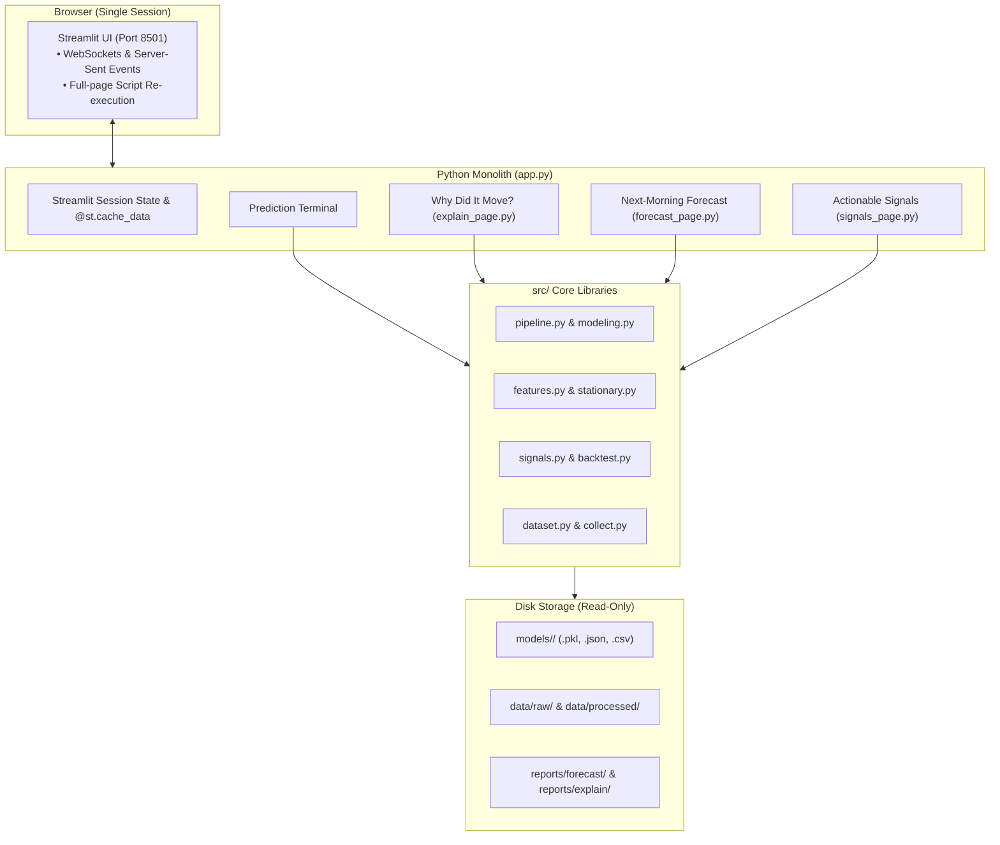
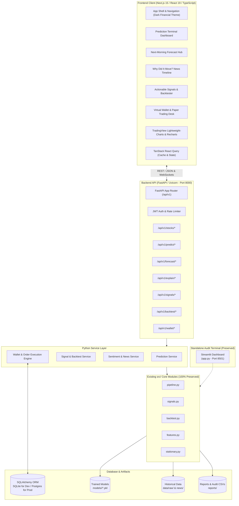
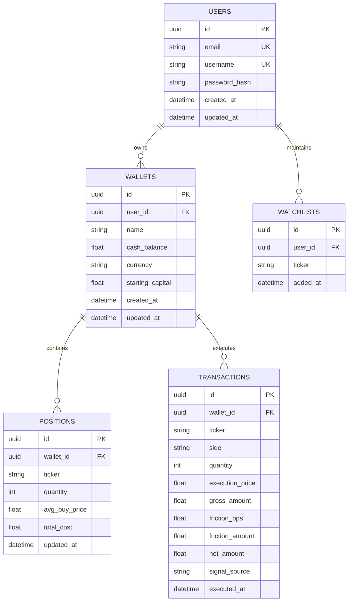
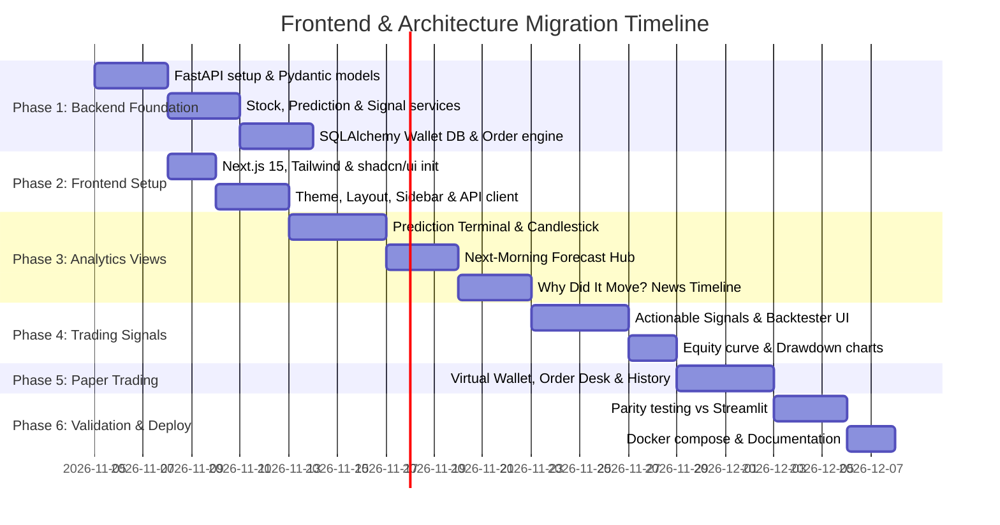

# Frontend & Architecture Migration Plan: Stock Market Predictor

**Document Version:** 1.0.0
**Project:** Stock Market Predictor — Professional Quantitative Financial Analytics Platform
**Target Stack:** Next.js (TypeScript, Tailwind CSS, shadcn/ui) + FastAPI (Python 3.13) + SQLite/PostgreSQL (SQLAlchemy)
**Coexistence Policy:** 100% preservation of existing Streamlit terminal, ML models, datasets, validation methodology, and backtests
**Date of Audit:** November 2026

---

## 1. Executive Summary & Migration Objectives

The Stock Market Predictor project currently operates as a standalone Python monolith built with Streamlit. Over successive research phases, the project has accumulated:
1. 10 fully trained, walk-forward validated machine learning models (`models/<STOCK>/`) based on 52 stationary financial indicators.
2. An **Overnight Next-Morning Forecast Engine** evaluating global market spillovers (US S&P 500, VIX, Asian indices) into Indian market openings.
3. An entity-targeted **FinBERT Financial Sentiment Engine** tracking 20,000+ corporate news headlines and stock-exchange filings with lead-lag causality.
4. An evidence-based **Actionable Trading Signal Engine** with 5 strategy variants, Indian statutory transaction friction (15.0 bps), and walk-forward backtesting.

### Primary Objectives of the Migration

- **Evolve into a Production Platform:** Decouple compute from presentation by introducing a modern, high-performance Next.js 15 frontend and an asynchronous FastAPI backend.
- **Introduce Virtual Paper Trading:** Add a virtual wallet with realistic Indian execution friction (STT, brokerage, exchange fees, stamp duty, GST, slippage) allowing users to paper-trade on top of model forecasts and actionable signals.
- **Preserve Existing Research (Zero Breaking Changes):** Retain all trained models (`model.pkl`), metadata (`metadata.json`), historical OHLCV data (`data/raw/`), news datasets, and walk-forward evaluations without retraining or altering outputs.
- **Dual-Engine Coexistence:** Keep the existing Streamlit application (`app.py`) running on port 8501 for internal quantitative auditing, while the new platform runs on port 3000 (Frontend) and port 8000 (API Backend).

---

## 2. Current Architecture vs. Proposed Architecture

### 2.1 Current Monolithic Architecture (Streamlit)



#### Limitations of Current Architecture:
1. **Coupled UI & Computation:** Every user interaction (changing a dropdown or slider) triggers a full-script rerun in Streamlit, causing unnecessary recalculations.
2. **No Persistent User Accounts or Wallets:** All state is transient within a single browser session. Virtual portfolios and trades cannot be persisted across sessions.
3. **Limited Frontend Interactivity:** Streamlit cannot deliver institutional-grade charting (e.g. TradingView-style interactive multi-timeframe pan/zoom, custom tooltips, order placement modals).
4. **No External API Access:** External applications, mobile clients, or automated trading bots cannot query predictions or signals programmatically.

---

### 2.2 Proposed Target Architecture (Decoupled Client-Server)



---

## 3. Inventory of Existing Modules to Reuse

The FastAPI backend will import directly from the existing `src/` modules without code duplication or retraining:

| Existing Module | Key Functions to Reuse | Role in Proposed Architecture |
| :--- | :--- | :--- |
| **[`src/config.py`](file:///C:/Users/vedan/Stock-Market-Predictor/src/config.py)** | `list_stocks()`, `get_stock()`, `Stock` dataclass, path constants | Single source of truth for stock registry, paths, and metadata. |
| **[`src/pipeline.py`](file:///C:/Users/vedan/Stock-Market-Predictor/src/pipeline.py)** | `load_artifacts()`, `predict_latest()`, `artifacts_exist()` | Serves 3-day model probabilities, operating points, and feature importances to `/api/v1/predict/*`. |
| **[`src/signals.py`](file:///C:/Users/vedan/Stock-Market-Predictor/src/signals.py)** | `get_latest_signal_status()`, `generate_signals()`, `calibrate_oof_probabilities()`, `classify_market_regimes()` | Powers the Actionable Signal Engine, multi-factor checklist, and regime detection endpoints. |
| **[`src/backtest.py`](file:///C:/Users/vedan/Stock-Market-Predictor/src/backtest.py)** | `run_walk_forward_backtest()`, `_compute_metrics()` | Powers real-time interactive backtesting queries with dynamic friction and cash rate parameters. |
| **[`src/dataset.py`](file:///C:/Users/vedan/Stock-Market-Predictor/src/dataset.py)** | `load_raw_ohlcv()`, `build_dataset()` | Serves historical OHLCV data to `/api/v1/stocks/{ticker}/prices`. |
| **[`src/features.py`](file:///C:/Users/vedan/Stock-Market-Predictor/src/features.py)** | `build_features()` | Computes moving averages, RSI, MACD, and Bollinger Bands for candlestick overlays. |
| **[`src/stationary.py`](file:///C:/Users/vedan/Stock-Market-Predictor/src/stationary.py)** | `add_stationary_features()`, `get_stationary_features()` | Generates normalized scale-free inputs for live model inference. |
| **[`src/abstention.py`](file:///C:/Users/vedan/Stock-Market-Predictor/src/abstention.py)** | `coverage_accuracy_curve()`, `confidence_from_proba()` | Supplies coverage-accuracy trade-off curves for model diagnostic views. |
| **[`reports/forecast/`](file:///C:/Users/vedan/Stock-Market-Predictor/reports/forecast/)** | Static CSVs: `stock_summary.csv`, `stock_by_year.csv`, `market_summary.csv` | Directly parsed by FastAPI to power the Next-Morning Forecast views. |
| **[`data/processed/news/`](file:///C:/Users/vedan/Stock-Market-Predictor/data/processed/news/)** | `<STOCK>_news_items.csv` (20,000+ items with entity FinBERT scores) | Serves the historical news feed and sentiment scatter plots for "Why Did It Move?". |
| **[`sentiment_study/reports/explain/`](file:///C:/Users/vedan/Stock-Market-Predictor/sentiment_study/reports/explain/)** | `lead_lag.csv`, `quintiles.csv`, `event_study.csv`, `big_moves_coverage.csv` | Feeds econometric lead-lag correlation and event study visualization endpoints. |

---

## 4. Proposed REST API Specification (FastAPI)

All endpoints will be prefixed with `/api/v1` and return strongly typed JSON payloads validated by Pydantic v2 schemas.

### 4.1 Stock Metadata & Price History

```text
GET /api/v1/stocks
Response: [
  {
    "ticker": "INFY",
    "display_name": "Infosys (INFY)",
    "sector": "Information Technology",
    "latest_close": 1115.00,
    "last_date": "2026-08-28",
    "status": "active"
  }, ...
]

GET /api/v1/stocks/{ticker}/prices?timeframe=1Y&interval=1D
Parameters:
  - timeframe: "1M" | "3M" | "6M" | "1Y" | "ALL"
  - interval: "1D"
Response: {
  "ticker": "INFY",
  "bars": [
    {"time": "2025-08-28", "open": 1050.2, "high": 1065.0, "low": 1045.0, "close": 1060.0, "volume": 5240000, "sma20": 1048.5, "sma50": 1020.1, "rsi": 54.2},
    ...
  ]
}
```

### 4.2 Prediction Terminal Endpoints

```text
GET /api/v1/stocks/{ticker}/prediction
Response: {
  "ticker": "INFY",
  "as_of_date": "2026-08-28",
  "horizon_days": 3,
  "signal": "UP",
  "calibrated_probability": 0.742,
  "confidence": 0.242,
  "confidence_threshold": 0.1399,
  "walk_forward_accuracy": 0.5395,
  "baseline_accuracy": 0.5525,
  "edge": -0.0130,
  "permutation_verdict": "NO SIGNAL",
  "fold_stability": [
    {"fold": 1, "accuracy": 0.585, "baseline": 0.520}, ...
  ],
  "top_features": [
    {"feature": "bb_bandwidth_zscore", "name": "BB Bandwidth (Z-Score)", "importance": -0.342}, ...
  ],
  "coverage_curve": [
    {"coverage": 1.0, "accuracy": 0.5395, "baseline": 0.5525},
    {"coverage": 0.30, "accuracy": 0.5864, "baseline": 0.5864}
  ]
}
```

### 4.3 Next-Morning Forecast Endpoints

```text
GET /api/v1/stocks/{ticker}/forecast?target=open&model=logistic
Parameters:
  - target: "open" (opening price) | "close" (closing price)
  - model: "logistic" | "lightgbm" | "xgboost"
Response: {
  "ticker": "INFY",
  "target": "Next morning's opening price",
  "model_family": "Logistic regression",
  "accuracy_guess": 0.585,
  "accuracy_model": 0.678,
  "accuracy_model_news": 0.680,
  "edge_points": 9.3,
  "p_value": 0.0008,
  "verdict": "SIGNAL",
  "overnight_features": [
    {"source": "US Market", "indicator": "S&P 500 Close & VIX", "status": "Available 06:00 IST"},
    {"source": "Asian Markets", "indicator": "Nikkei 225, KOSPI, Hang Seng", "status": "Available 08:30 IST"},
    {"source": "Domestic", "indicator": "Pre-open SGX/GIFT Nifty & Technicals", "status": "Available 09:00 IST"}
  ],
  "annual_breakdown": [
    {"year": 2024, "acc_model": 0.682, "acc_guess": 0.590, "test_days": 245}, ...
  ]
}

GET /api/v1/forecast/summary?target=open
Response: Cross-stock leaderboard sorting all 10 stocks by forecast edge.
```

### 4.4 "Why Did It Move?" Sentiment Endpoints

```text
GET /api/v1/stocks/{ticker}/news?limit=50&offset=0&exclude_price_reports=true
Response: {
  "ticker": "INFY",
  "items": [
    {
      "id": "infy-2025-12-18-01",
      "trade_date": "2025-12-18",
      "published": "2025-12-18 08:45:00",
      "source": "NSE filing",
      "entity": "Infosys",
      "title": "Infosys signs $1.5B cloud transformation contract with global enterprise",
      "targeted_sentiment": 0.884,
      "plain_sentiment": 0.620,
      "price_report": false,
      "day_return_pct": 2.14
    }, ...
  ]
}

GET /api/v1/stocks/{ticker}/sentiment/lead-lag
Response: Spearman correlation series from lag -3 days to +3 days.
```

### 4.5 Actionable Signals & Backtesting Endpoints

```text
GET /api/v1/stocks/{ticker}/signals/latest?variant=C&friction_bps=15.0
Response: {
  "ticker": "INFY",
  "as_of_date": "2026-08-18",
  "latest_close": 1115.00,
  "signal": "BUY",
  "signal_label": "BUY",
  "calibrated_proba_up": 0.742,
  "confidence": 0.242,
  "expected_gross_return": 0.0176,
  "cost_hurdle": 0.0015,
  "net_expectancy": 0.0161,
  "rationale": "BUY: Model (74.2%) confirmed by FinBERT sentiment (+0.00)",
  "multi_factor_matrix": {
    "model": {"status": "Bullish", "value": 0.742, "passed": true},
    "rsi": {"status": "Safe Range", "value": 40.1, "passed": true},
    "macd": {"status": "Bearish", "value": -0.004, "passed": false},
    "sentiment": {"status": "Neutral", "value": 0.00, "passed": true},
    "regime": {"status": "SIDEWAYS_CHOPPY", "passed": true}
  }
}

POST /api/v1/stocks/{ticker}/backtest
Request Body: {
  "variant": "C",
  "long_only": true,
  "friction_bps": 15.0,
  "risk_free_rate": 0.05,
  "starting_capital": 100000.0
}
Response: {
  "ticker": "INFY",
  "variant": "Variant C: Model + Sentiment Confirmation",
  "metrics": {
    "strategy": {
      "cagr": 0.1060,
      "sharpe": 0.27,
      "sortino": 0.38,
      "max_drawdown": 0.3090,
      "win_rate": 0.624,
      "profit_factor": 1.48,
      "total_trades": 194,
      "time_in_market": 0.561,
      "friction_bps": 2910.0
    },
    "buy_and_hold": {
      "cagr": 0.1213,
      "sharpe": 0.27,
      "max_drawdown": 0.4551
    },
    "cash": {
      "cagr": 0.0488,
      "sharpe": 0.0,
      "max_drawdown": 0.0
    }
  },
  "equity_curve": [
    {"date": "2013-07-12", "strategy": 100000.0, "buy_hold": 99925.0, "cash": 100000.0, "drawdown": 0.0}, ...
  ],
  "trades": [
    {"id": 1, "entry_date": "2013-07-12", "entry_price": 248.75, "exit_date": "2013-07-25", "exit_price": 258.61, "days_held": 9, "net_return": 0.0381}, ...
  ]
}
```

### 4.6 Virtual Wallet & Paper Trading Endpoints

```text
GET /api/v1/wallet
Headers: Authorization: Bearer <token> (or default demo user)
Response: {
  "wallet_id": "w-01",
  "cash_balance": 842500.00,
  "portfolio_value": 1015800.00,
  "total_invested": 150000.00,
  "unrealized_pnl": 23300.00,
  "realized_pnl": 15800.00,
  "total_pnl_pct": 0.0158
}

GET /api/v1/wallet/positions
Response: [
  {
    "ticker": "INFY",
    "quantity": 100,
    "avg_buy_price": 1085.00,
    "current_price": 1115.00,
    "current_value": 111500.00,
    "unrealized_pnl": 3000.00,
    "unrealized_pnl_pct": 0.0276
  }
]

POST /api/v1/wallet/trade
Request Body: {
  "ticker": "INFY",
  "side": "BUY",
  "quantity": 50,
  "signal_source": "Actionable Signals (Variant C)"
}
Response: {
  "transaction_id": "tx-9921",
  "status": "FILLED",
  "ticker": "INFY",
  "side": "BUY",
  "quantity": 50,
  "price": 1115.00,
  "gross_amount": 55750.00,
  "friction_paid": 41.81,  // 7.5 bps entry fee (STT, brokerage, stamp duty)
  "net_cash_deducted": 55791.81,
  "executed_at": "2026-11-04T17:10:00Z"
}

GET /api/v1/wallet/transactions?limit=50
Response: List of historical executed paper trades with full friction breakdown.

POST /api/v1/wallet/reset
Response: Resets paper wallet balance back to initial capital (₹1,000,000).
```

---

## 5. Database Schema Design (SQLAlchemy / SQLite / PostgreSQL)

For virtual paper trading, user watchlists, and persistent trade history, a relational database will be implemented using **SQLAlchemy 2.0 ORM** with **Alembic** migrations.

- **Local Development:** SQLite (`data/app.db`) for instant zero-dependency execution.
- **Production/Cloud:** PostgreSQL via `asyncpg`.



### Table Specifications:

1. **`users`**:
   - `id`: UUID (Primary Key)
   - `email`: VARCHAR(255), Unique, Indexed
   - `username`: VARCHAR(100), Unique
   - `password_hash`: VARCHAR(255)
   - `created_at`: TIMESTAMP
2. **`wallets`**:
   - `id`: UUID (Primary Key)
   - `user_id`: UUID (Foreign Key `users.id`)
   - `cash_balance`: NUMERIC(15, 2), Default: 1,000,000.00
   - `starting_capital`: NUMERIC(15, 2), Default: 1,000,000.00
   - `currency`: VARCHAR(3), Default: "INR"
3. **`positions`**:
   - `id`: UUID (Primary Key)
   - `wallet_id`: UUID (Foreign Key `wallets.id`, Indexed)
   - `ticker`: VARCHAR(20), Indexed
   - `quantity`: INTEGER (Must be $> 0$ for active holding)
   - `avg_buy_price`: NUMERIC(12, 4)
   - `total_cost`: NUMERIC(15, 2)
4. **`transactions`**:
   - `id`: UUID (Primary Key)
   - `wallet_id`: UUID (Foreign Key `wallets.id`, Indexed)
   - `ticker`: VARCHAR(20), Indexed
   - `side`: VARCHAR(4) (Check constraint: `BUY`, `SELL`)
   - `quantity`: INTEGER
   - `execution_price`: NUMERIC(12, 4)
   - `gross_amount`: NUMERIC(15, 2)
   - `friction_bps`: NUMERIC(6, 2), Default: 7.50 (one-way)
   - `friction_amount`: NUMERIC(12, 2)
   - `net_amount`: NUMERIC(15, 2)
   - `signal_source`: VARCHAR(100) (e.g., "Actionable Signals", "Next-Morning Forecast", "Manual")
   - `executed_at`: TIMESTAMP, Indexed

---

## 6. Frontend Platform Architecture (Next.js 15)

### 6.1 Component & Page Hierarchy

```text
frontend/
├── app/
│   ├── layout.tsx                # App shell, Dark theme provider, QueryClientProvider
│   ├── page.tsx                  # Market overview & cross-stock performance dashboard
│   ├── terminal/
│   │   └── page.tsx              # Prediction Terminal (3-day direction, fold stability, coverage)
│   ├── forecast/
│   │   └── page.tsx              # Next-Morning Forecast (overnight global markets, annual trends)
│   ├── explain/
│   │   └── page.tsx              # Why Did It Move? (FinBERT sentiment timeline & event studies)
│   ├── signals/
│   │   └── page.tsx              # Actionable Signals & Backtesting (Variants A-E, equity curves)
│   └── wallet/
│       └── page.tsx              # Virtual Paper Trading Desk (balance, positions, order ticket)
├── components/
│   ├── ui/                       # shadcn/ui components (buttons, badges, cards, dialogs, tabs)
│   ├── charts/
│   │   ├── CandlestickChart.tsx  # TradingView Lightweight-Charts with SMA/EMA overlays
│   │   ├── EquityCurveChart.tsx  # Interactive Recharts Strategy vs Buy&Hold vs Cash curve
│   │   ├── DrawdownChart.tsx     # Underwater drawdown area chart
│   │   ├── SentimentScatter.tsx  # Interactive news-to-return scatter plot
│   │   └── CoverageChart.tsx     # Accuracy vs Confidence coverage curve
│   ├── navigation/
│   │   ├── Sidebar.tsx           # Institutional dark sidebar with stock picker
│   │   └── Header.tsx            # Live ticker tape, status pills, wallet summary
│   └── trading/
│       ├── OrderTicketModal.tsx  # Buy/Sell modal with friction calculator
│       └── PositionTable.tsx     # Real-time holdings table with live P&L
├── lib/
│   ├── api.ts                    # Axios / Fetch client targeting FastAPI (/api/v1)
│   ├── types.ts                  # TypeScript interfaces matching backend Pydantic models
│   └── utils.ts                  # Currency formatters (₹ Lakh / Crore), date helpers
```

### 6.2 Design System & Theming
- **Base Theme:** Dark Financial Terminal locked (matches the existing Streamlit theme):
  - Main Background: `#0b0f19` (Charcoal Navy)
  - Card & Container Surface: `#121824` (Dark Slate)
  - Card Border: `#1f293d`
  - Typography: `Inter` for prose and headings; `Space Mono` / `JetBrains Mono` for tickers, numbers, and probabilities.
  - Accent Palette: Emerald Green (`#10b981`), Rose Red (`#ef4444`), Amber (`#f59e0b`), Royal Blue (`#3b82f6`), Purple (`#8b5cf6`).

---

## 7. Migration Execution Phases



### Phase Details

#### Phase 1: FastAPI Backend Foundation
- Scaffold `backend/` directory with `app/main.py` and router modules.
- Create Pydantic v2 response schemas for all 4 views.
- Implement services wrapping `src/pipeline.py`, `src/signals.py`, `src/backtest.py`.
- Configure SQLAlchemy 2.0 with SQLite engine (`data/wallet.db`) and create Alembic migrations.

#### Phase 2: Next.js 15 Frontend Scaffolding
- Initialize `frontend/` using `create-next-app` with TypeScript, Tailwind CSS, App Router, and ESLint.
- Install `shadcn/ui` components (`card`, `button`, `badge`, `tabs`, `dialog`, `select`, `table`).
- Implement the dark terminal theme, sidebar navigation, and stock selector.

#### Phase 3: Analytics Dashboards (Prediction, Forecast, News)
- Migrate **Prediction Terminal**: OHLCV candlestick chart (Lightweight-Charts), coverage curves, feature importance, fold stability.
- Migrate **Next-Morning Forecast**: Overnight market indicators, annual accuracy comparison, target selector.
- Migrate **Why Did It Move?**: News headline feed with FinBERT sentiment pills, lead-lag correlation charts.

#### Phase 4: Actionable Signals & Interactive Backtester
- Implement live signal badge (`BUY` / `SELL` / `HOLD`) with dynamic net expectancy vs. friction hurdle.
- Multi-factor matrix (Model, RSI, MACD, FinBERT, Regime).
- Interactive walk-forward backtest runner with dynamic friction slider and risk-free rate toggles (0% vs 5%).
- Recharts-based equity curve, underwater drawdown, and completed trade execution log.

#### Phase 5: Virtual Wallet & Paper Trading Desk
- Implement paper trading order ticket modal on any signal or chart page.
- Track real-time holdings, cash balances, and executed transactions with Indian statutory friction accounting.
- Portfolio summary page displaying total return, realized/unrealized P&L, and position allocation donut.

#### Phase 6: End-to-End Testing & Parity Verification
- Verify that every metric, probability, and backtest curve matches Streamlit outputs to 6 decimal places.
- Dockerize backend (`Dockerfile.backend`) and frontend (`Dockerfile.frontend`) with `docker-compose.yml`.
- Verify that the Streamlit application on port 8501 remains untouched and functional.

---

## 8. Testing & Parity Verification Strategy

To guarantee that the migration introduces zero errors or distortions:

1. **API Parity Tests (Pytest + FastAPI TestClient):**
   - For all 10 stocks, compare `/api/v1/stocks/{ticker}/prediction` output against direct output from `src/pipeline.py:predict_latest()`. Must match to 6 decimal places.
   - For all 50 stock-variant pairs, compare `/api/v1/stocks/{ticker}/backtest` output against `reports/actionable_signal_results.csv`. Cumulative return, CAGR, Sharpe, and Drawdown must match identically.
2. **Deterministic Backtest Invariance:**
   - Execute unit tests ensuring that backtesting with `friction_bps = 15.0` and `risk_free_rate = 0.05` produces the verified metrics documented in [`reports/actionable_signal_independent_review.md`](file:///C:/Users/vedan/Stock-Market-Predictor/reports/actionable_signal_independent_review.md).
3. **Database Concurrency & Transaction Safety:**
   - Test simultaneous paper trade executions to verify ACID transaction compliance, preventing negative cash balances or race conditions.
4. **Frontend Visual & End-to-End Regression (Playwright):**
   - Capture automated screenshots of Next.js pages and compare against existing Streamlit screenshots in `screenshots/`.
   - Verify responsive rendering on desktop (1920x1080) and laptop (1366x768).

---

## 9. Compatibility Risks & Mitigation

| Risk | Severity | Technical Root Cause | Mitigation Strategy |
| :--- | :---: | :--- | :--- |
| **Python 3.13 Runtime Compatibility** | **Low** | Some older C-extensions may lack prebuilt wheels for Python 3.13. | The existing `.venv` is already running Python 3.13.7 with all dependencies working. FastAPI, Pydantic v2, and SQLAlchemy 2.0 have full native Python 3.13 support. |
| **Execution Latency in Backtesting** | **Medium** | Calculating full walk-forward backtests on the fly across 10 years of data can take 1–2 seconds. | Implement in-memory caching (`async-lru` or Redis) in the FastAPI service layer. Store precomputed backtests for default variants and compute dynamically only when users adjust custom friction sliders. |
| **Chart WebGL / Canvas Rendering** | **Low** | Plotly React bundle size is large (~3 MB). | Standardize on **TradingView Lightweight Charts** (only 45 KB) for candlestick charts and **Recharts** (SVG-based) for equity curves. Keeps frontend bundle ultra-fast. |
| **Port Conflicts** | **Low** | Streamlit default (8501), FastAPI default (8000), Next.js default (3000). | Explicitly bind FastAPI to `0.0.0.0:8000`, Next.js to `3000`, and Streamlit to `8501`. Update CORS to allow requests between 3000 and 8000. |
| **Data Drift / Leakage During Migration** | **High** | Changing data loading logic could accidentally re-introduce lookahead bias. | The backend will import existing `src/` modules as read-only libraries. The underlying data-loading and stationary transformation pipeline will not be modified. |

---

## 10. Conclusion & Next Steps

This migration plan outlines a production-grade path to evolve the Stock Market Predictor into an institutional-grade platform while protecting the academic and quantitative research already achieved.

**Status:** Awaiting user approval before scaffolding `backend/` and `frontend/`.
